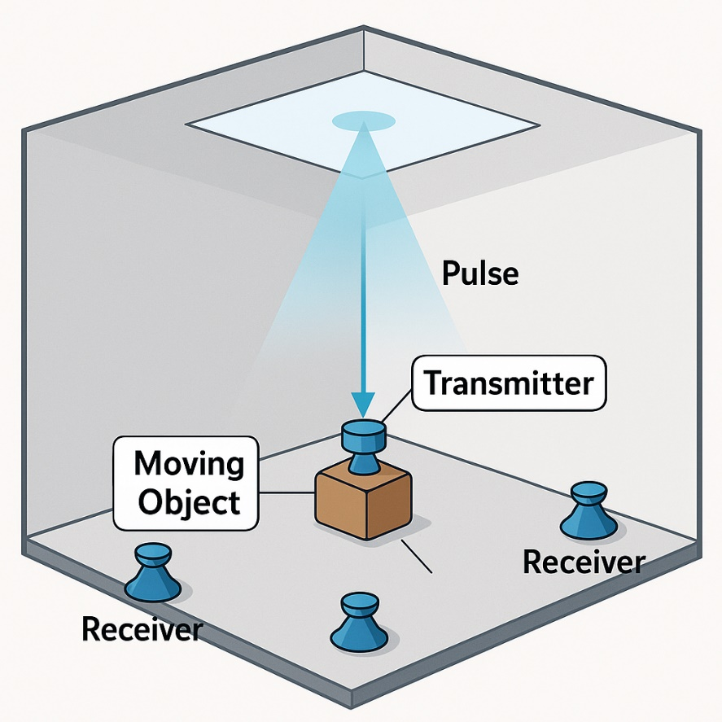
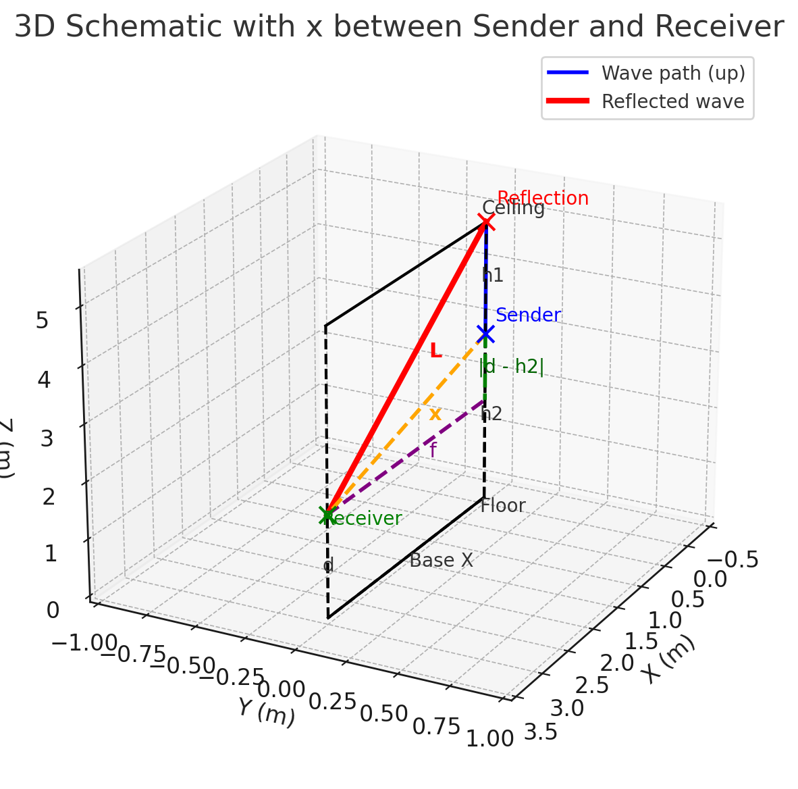
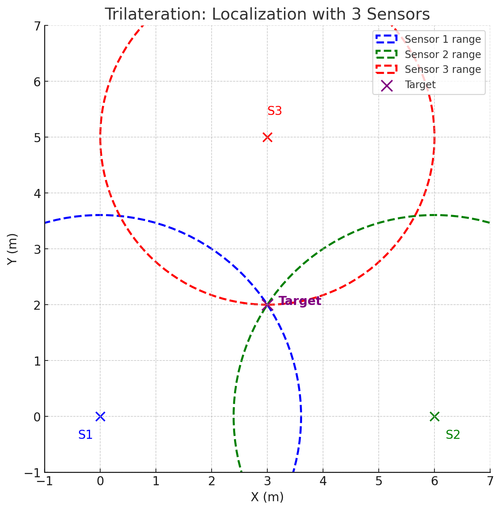
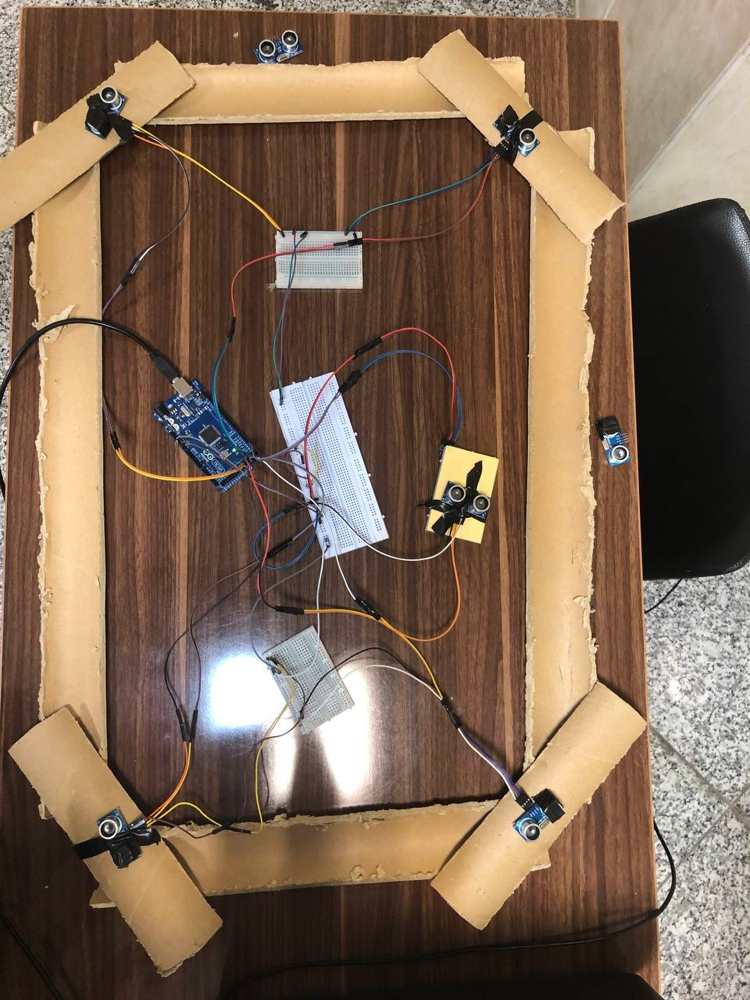
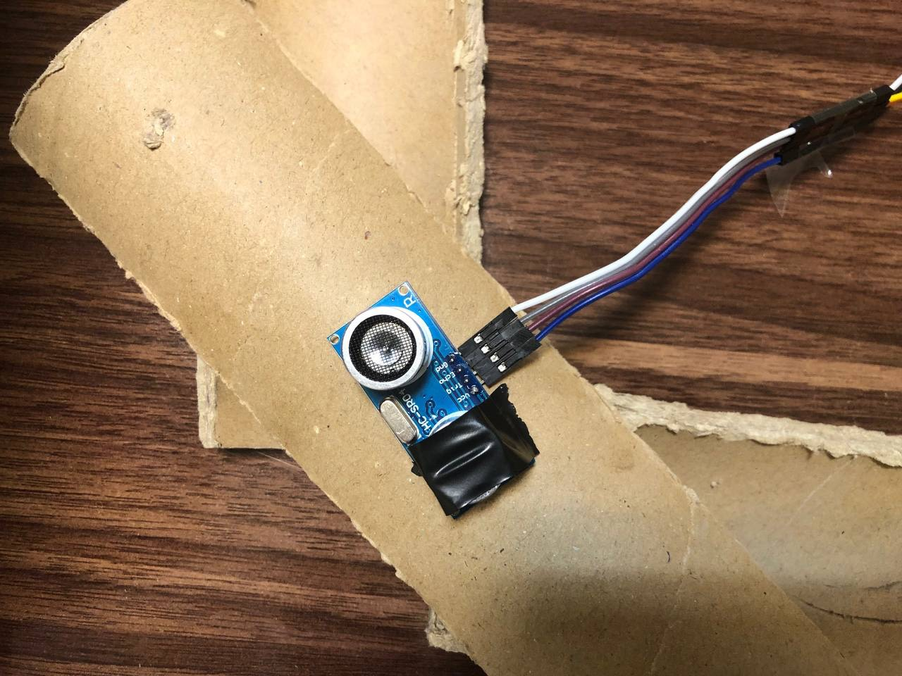
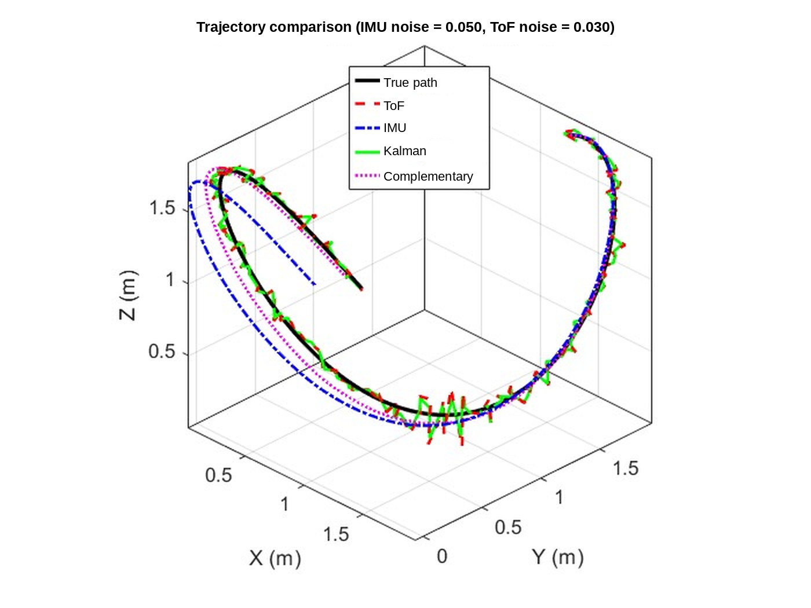
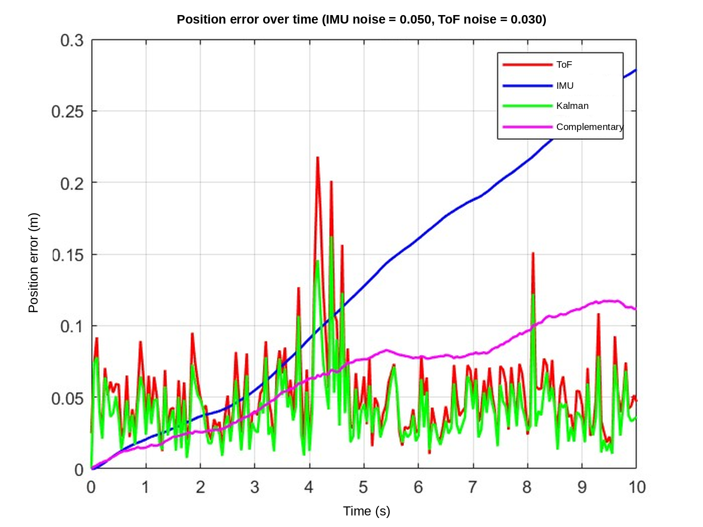

# ultrasonic-ceiling-localization

A low-cost 3D indoor positioning system that tracks a moving object using **one ultrasonic transmitter and four ground-level receivers**, exploiting **reflection off the ceiling** to cover the whole workspace. A downward-facing **laser rangefinder** measures the object's height in real time, so the system keeps working when the object is lifted, moves under a table, or operates beneath ceilings of different heights.

Developed for the *Measurement Systems* course (Phase 2), Faculty of Mechanical Engineering, University of Tehran.



---

## Key ideas

### 1. Wide coverage with minimal hardware
A single HC-SR04 ultrasonic sensor has a narrow field of view (roughly 15°). Covering even a 1 m × 1 m area by direct line of sight would require many sensors. Here the transmitter on the moving object fires **upward**; the wave **reflects off the ceiling** and spreads over the floor, where only **4 receivers** at the corners pick it up. The ceiling effectively widens each sensor's coverage from a narrow cone to the whole room.

### 2. Automatic height compensation with a laser
A VL53L0X (GY-53) time-of-flight laser mounted under the object measures its height above the floor. This value is fed directly into the geometry, so:
- the object can be lifted off the ground,
- the ceiling height can differ between environments,
- the object can pass under obstacles (e.g. a table) and still be localized correctly.

---

## How it works & Mathematical Formulation

### 1. Synchronized 5-Sensor Architecture
The system uses five HC-SR04 modules (`d1` to `d5`) connected to an Arduino Mega 2560:
- **1 Moving Transceiver:** Mounted on the moving object facing upward. It emits the 40 kHz ultrasonic burst toward the ceiling and can also record the direct vertical echo from the ceiling.
- **4 Corner Receivers:** Placed at known coordinates $(x_i, y_i, 0)$ on the floor ($i \in \{1, 2, 3, 4\}$). By triggering all modules synchronously (whilst muting or masking the transmitters on the four floor receivers), each corner sensor measures the one-way Time-of-Flight (ToF) of the ceiling-reflected wave. Note that because the HC-SR04 firmware divides round-trip time by 2, the raw reading on a passive receiver corresponds to half the total reflected path length $L_i$.

### 2. Ceiling-Reflection Geometry (Virtual Source Method)
Let the moving object be at $(x, y, z)$, where $z$ is measured directly by the downward-facing VL53L0X laser rangefinder, and let $H$ be the ceiling height. 

By the law of specular reflection, a wave travelling from the object at height $z$ to the ceiling at height $H$ and reflecting down to a floor receiver at $z = 0$ is geometrically equivalent to a straight line originating from a **virtual mirror source** above the ceiling at height:

$$Z_{\text{eff}} = (H - z) + H = 2H - z$$

*(If the upward-facing transceiver directly measures the ceiling clearance $h_c = H - z$, this virtual vertical distance simplifies to $Z_{\text{eff}} = 2h_c + z$ without requiring prior knowledge of $H$.)*

Given the total acoustic path length $L_i$ from the transmitter to the $i$-th floor receiver via the ceiling, the horizontal radial distance $r_i$ in the $XY$-plane is obtained via the Pythagorean theorem:

$$r_i = \sqrt{L_i^2 - (2H - z)^2}$$



### 3. 2D Trilateration via Nonlinear Least Squares
Once the horizontal radii $r_1, r_2, r_3, r_4$ to the four corner receivers at $(x_i, y_i)$ are recovered, the object's planar coordinates $(x, y)$ are estimated by minimizing the squared range residuals across all four receivers:

$$(\hat{x}, \hat{y}) = \arg\min_{(x, y)} \sum_{i=1}^{4} \left( \sqrt{(x - x_i)^2 + (y - y_i)^2} - r_i \right)^2$$

Combining $(\hat{x}, \hat{y})$ with the laser height $z$ yields the full 3D position $(x, y, z)$, which is streamed over serial and visualized live in 3D.



---

## Physical prototype

The prototype uses an Arduino Mega 2560 and HC-SR04 modules mounted on a cardboard frame (a 5-sensor setup: one transmitter on the moving unit and four corner receivers), with the laser module mounted underneath the moving unit.





### Live run

Real-time 3D position display in MATLAB while the hardware is running (ultrasonic channels `d1` to `d5`, laser height `z`, and the estimated `X, Y, Z` coordinates).


---

## Repository structure

```text
.
├── arduino/
│   └── ultrasonic_laser_tracker/   # Firmware: 5x HC-SR04 + VL53L0X, CSV over serial
├── matlab/
│   ├── simulation/                 # ToF / IMU / Kalman / complementary comparison
│   └── live_gui/                   # Real-time 3D visualization + robust trilateration
├── images/                         # Setup photos and result plots
└── README.md
```

## Hardware

| Part | Qty | Role |
|---|---|---|
| HC-SR04 ultrasonic module | 5 (1 transmitter + 4 receivers) | Ceiling-reflected time-of-flight ranging |
| VL53L0X / GY-53 laser module | 1 | Direct height ($z$) measurement above floor |
| Arduino Mega 2560 | 1 | Multi-channel echo timing and serial output |

## Getting started

**Firmware**
1. Install the `Adafruit_VL53L0X` library.
2. Open `arduino/ultrasonic_laser_tracker/ultrasonic_laser_tracker.ino` in the Arduino IDE, check the trig/echo pins, and upload to an Arduino Mega 2560.
3. The board prints one CSV line per measurement cycle (5 ultrasonic distances + laser height, in cm) at 9600 baud.

**Live visualization (MATLAB)**
1. Set the serial port in `matlab/live_gui/UltrasonicTrackerApp_Debug.m` (baud rate must match the firmware).
2. Run `UltrasonicTrackerApp_Debug` to see the parsed distances, the estimated $(x, y, z)$, and the 3D scene.

**Simulation (MATLAB)**
Run `matlab/simulation/sensor_fusion_simulation.m`. It requires the Optimization Toolbox (`lsqnonlin`).

---

## Simulation results

Setup: 2 × 2 × 2 m cube, four floor sensors, 3D sinusoidal trajectory (10 s, 0.05 s step), Gaussian noise on distance and IMU measurements. Position RMS error in metres, for IMU noise = 0.02:

| ToF noise | ToF only | IMU only (drift) | Kalman | Complementary |
|---|---|---|---|---|
| 0.01 | 0.0187 | 0.0764 | **0.0160** | 0.0410 |
| 0.03 | 0.0651 | 0.1081 | **0.0413** | 0.0458 |
| 0.06 | 0.1157 | 0.1184 | **0.0505** | 0.0518 |

IMU-only integration drifts rapidly; fusing it with ToF measurements via a Kalman filter gives the lowest error at every tested noise level, while the complementary filter serves as a lightweight alternative for low-power microcontrollers. Exact values vary slightly between runs due to random noise seeds.




> **Note:** IMU fusion (Kalman / complementary filters) is evaluated in simulation. The physical prototype demonstrates real-time 3D localization using the ultrasonic + laser architecture.

## Error sources and mitigation

- **Hardware:** HC-SR04 timing resolution and noise; laser instability on highly absorptive or angled surfaces.
- **Environmental:** Speed of sound varies by ~0.6 m/s per °C; ceiling roughness can introduce multipath reflections. *Mitigation:* Temperature compensation and first-arrival thresholding.
- **Geometry (GDOP):** Symmetric receiver placement at the workspace corners minimizes Geometric Dilution of Precision (GDOP).

## Future work

- Temperature-compensated speed of sound using an onboard thermistor/DHT sensor
- Real-time onboard Kalman filtering integrating a 6-DOF IMU
- Coded acoustic signals (chirp / PRN) to improve SNR and reject multipath
- Quantitative experimental trajectory evaluation against an optical ground-truth reference

## Team and contributions

Team project of three students. Supervisor: Dr. Ayati, University of Tehran, 2025.

- **Adib Saffari**: Overall system architecture and the ceiling-reflection sensing mechanism (one upward transmitter, four floor receivers); geometric formulation for extracting 2D radii from reflected acoustic paths; integration of the downward-facing laser rangefinder for real-time height compensation.
- **Soheil Dehghani** and **Seyed Mohammad Hossein Emami**: IMU-based state estimation (dead-reckoning integration, Kalman and complementary filter design), and MATLAB implementation of the sensor-fusion simulation and numerical solvers.

## License

MIT
